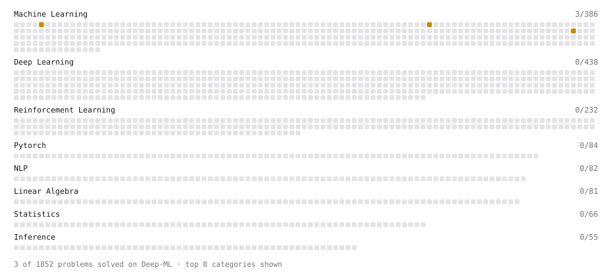

# Deep-ML

My machine learning practice from [Deep-ML](https://www.deep-ml.com). Every solution here was written by hand.

**5** solved · 3 problems · 0 labs · 2 math

[**Browse the interactive portfolio**](https://Akshith2.github.io/deep-ml/) to replay this filling in over time.

## Problems

| | Difficulty | Solved | |
| --- | --- | --- | --- |
| [Bias-Variance Decomposition from Bootstrap](https://www.deep-ml.com/problems/804) | medium | 2026-10-30 | [solution](problems/0804-bias-variance-decomposition-from-bootstrap) |
| [Implement K-Fold Cross-Validation](https://www.deep-ml.com/problems/18) | medium | 2026-10-29 | [solution](problems/0018-implement-k-fold-cross-validation) |
| [Implement Stratified Train-Test Split](https://www.deep-ml.com/problems/275) | medium | 2026-10-28 | [solution](problems/0275-implement-stratified-train-test-split) |

## Math

| | Difficulty | Solved | |
| --- | --- | --- | --- |
| [Regularization and Generalization](https://www.deep-ml.com/math-problems/31) | medium | 2026-10-30 | [solution](math/0031-regularization-and-generalization) |
| [Interpolation and Double Descent](https://www.deep-ml.com/math-problems/118) | hard | 2026-10-30 | [solution](math/0118-interpolation-and-double-descent) |

---

_This file is regenerated by Deep-ML on every push._
